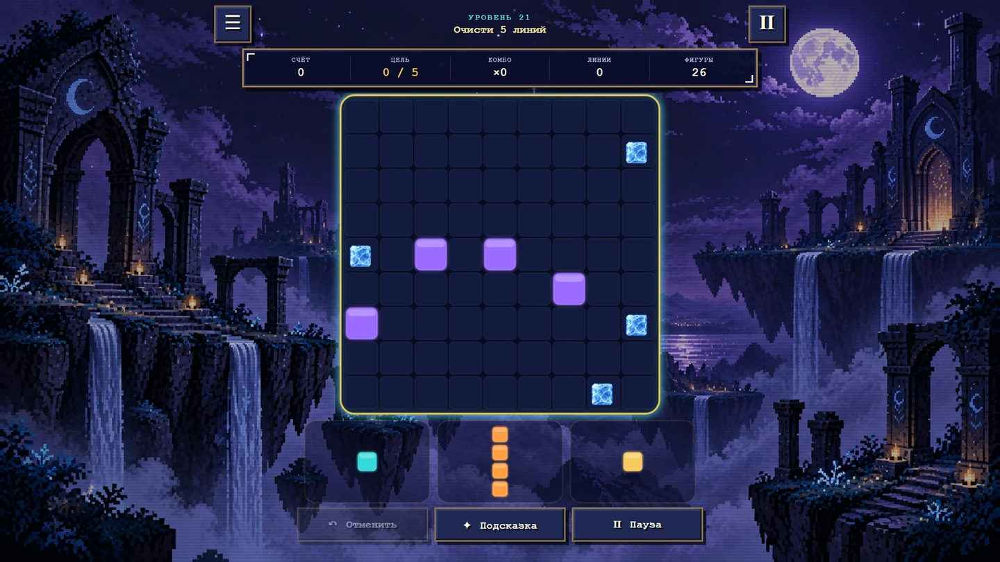
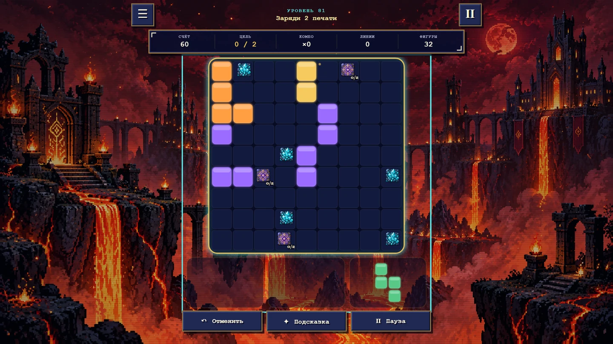

# Rune Blocks / Рунные Блоки

Головоломка на поле 9×9. Расставляйте рунические фигуры, очищайте линии и выполняйте цели уровней.

- Кампания из 100 уровней, бесконечный режим и ежедневное испытание.
- TypeScript, React, Canvas 2D и Vite.

## Запуск

```bash
npm ci
npm run dev
```

`npm test` проверяет механику. `npm run validate:campaign` проверяет уровни кампании.

## Скриншоты



